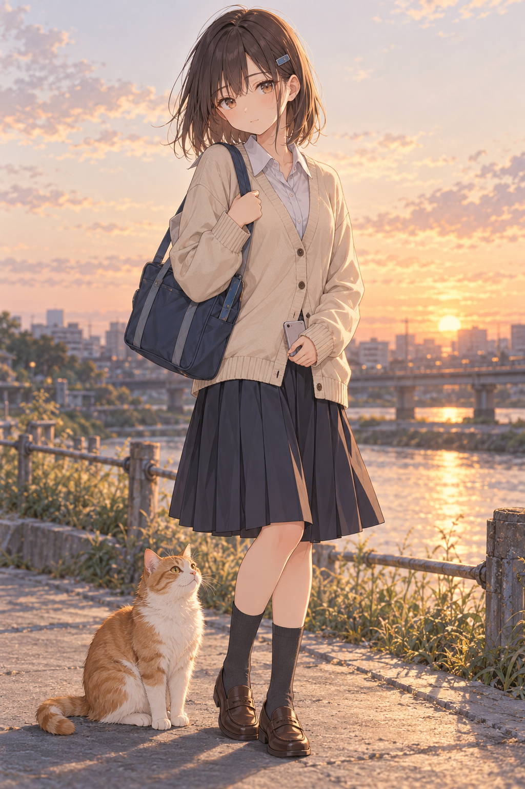

# 七濑的日常生活

探索人格、记忆、生活与对话

住在东京的16岁高中女生。喜欢猫、音游、粗点心，还有傍晚河堤上的晚霞。作业总想晚一点再做，妈妈上夜班时，却会张罗晚饭，催弟弟洗碗。家里的茶白猫 **むぎ**，偏偏喜欢睡在她的讲义上。

 

## 框架

## 未来的构思

- 记住共同经历。
- 让生活自然地影响聊天。
- 保持人物、场景与图片记忆的连续性。
- 让关系随着相处慢慢变化。
- 优化图片、译文和移动端体验。
- 完善成本控制与故障恢复。

## 部署

交给你的 Agent 部署，它知道该怎么做。
